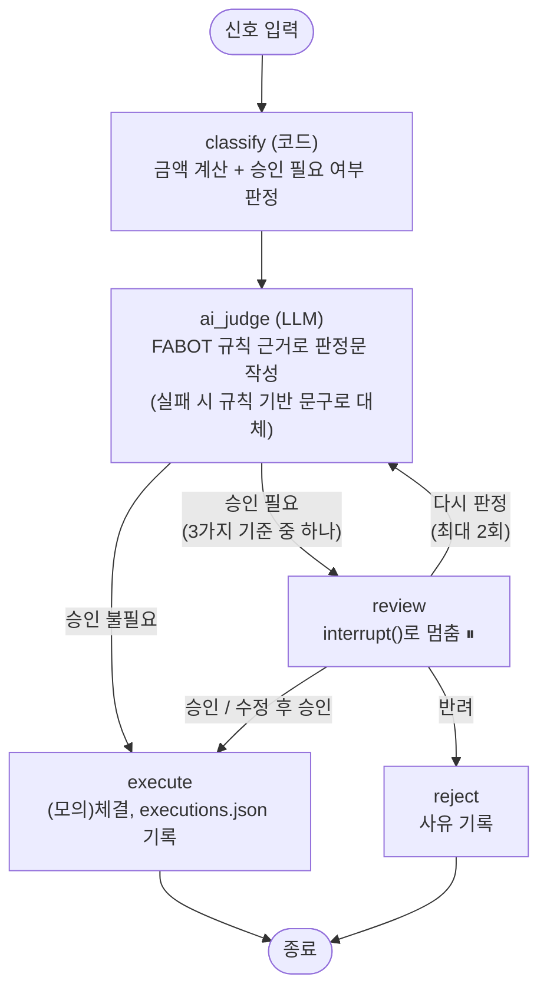

# REPORT — FABOT 매매 승인 에이전트 (Human-in-the-Loop)

AI 에이전트 과정 "사람이 승인하는 에이전트 만들기" 메인퀘스트 제출 보고서.

## 1. 주제와 고른 이유

**자동화한 업무**: FABOT(F&G 지수 기반 규칙 투자 자동매매)의 매매 신호 실행. F&G 점수를
보고 TQQQ를 사고팔거나 커버드콜(472150)을 정기매수하는 결정 자체는 이미 코드로 자동화돼
있다(`fabot-auto-trade`). **결과가 바깥으로 나가는 지점은 실제 증권사 계좌에 주문이
들어가는 순간**이다 — 주문이 체결되면 돈이 실제로 움직이고, 되돌리려면 반대 매매를
또 해야 해서 시세 차이만큼 손해를 본다.

**왜 이 주제인가**: 실습에서 다룬 환불 승인과 성격이 같다 — 자동 판단이 있고, 그 판단이
바로 돈이 나가는 행동으로 이어지고, 건마다 위험 크기가 다르다(F&G≤15 100% 매수와
F&G≤25 25% 매수는 되돌릴 수 없다는 점은 같아도 위험 크기가 다르다). CLAUDE.md에 이미
"① 절대 규칙: 실제 주문 실행은 사람 승인 없이는 안 함"이라는 원칙이 있는데, 지금까지는
이게 "사람이 자동매매 스크립트를 아예 안 돌린다"는 수동적인 방식이었다 — 이번 과제로
이걸 **진짜 interrupt/resume 구조**로 만들었다.

**⚠️ 중요 — 이번 한 번만 넣는 장치**: FABOT의 실제 최종 목표는 **사람 개입이 전혀 없는
완전 자동화**다(가족 배당소득 상한 관리, F&G 신호 판정까지 이미 24시간 자동으로 돈다).
이 승인 단계는 이번 HITL 과제가 요구하는 구조를 만들기 위해 의도적으로 넣은 것이지,
FABOT의 실제 운영 방향을 바꾸는 게 아니다. 그래서 이 프로젝트는 실제 증권사 API에
연결하지 않고, 신호·체결을 전부 로컬 파일로 모의(simulate)한다 — 과제용 장치가 실제
운영 계좌나 KIS·Kiwoom 자동매매 스크립트에 영향을 주면 안 되기 때문이다.

## 2. 파이프라인 구조도



**State**: `signal`(신호 원본) · `amount_krw`(계산된 금액) · `needs_approval`(승인 필요
여부) · `stop_reason`(멈춘 이유) · `ai_reasoning`(AI 판정문) · `human_decision`
(approve/modify/reject/retry) · `human_feedback` · `final_amount_krw` · `executed` ·
`rejected` · `retry_count` · `log`(누적 로그, `Annotated[list, operator.add]`).

**멈추는 지점**: `review` 노드 안의 `interrupt({...})` 호출 한 곳뿐이다. **재개 경로**:
`Command(resume={"action": ..., ...})`를 같은 `thread_id`(신호 id)로 다시 `.invoke()`하면
`review` 노드가 처음부터 재실행되고(섹션 2 강의의 경고 그대로 — 그래서 `review`에는
interrupt 이전 부작용을 두지 않았다), `interrupt()`가 이번엔 담당자의 답을 그대로
반환한다.

**체크포인터**: `SqliteSaver`를 파일(`data/checkpoints.sqlite`)에 연결했다(강의가 권한
`InMemorySaver`가 아니라 파일 기반을 씀 — 앱을 껐다 켜도 대기 건이 남아야 하기 때문).
**실제로 검증**: 완전히 새 파이썬 프로세스에서 `graph.get_snapshot("S15").next`를
호출해 `('review',)`가 그대로 나오는 것을 확인했다 — 프로세스가 죽어도 대기 상태가
사라지지 않는다.

## 3. 승인 기준과 그 이유

계산 가능한 형태로 세 가지를 정했다(`graph.py`의 `needs_approval()`), 서로 다른 위험
하나씩 막는다:

| # | 기준 | 막으려는 위험 | 자동 통과되는 예 |
|---|---|---|---|
| 1 | TQQQ **매수 비중 100%**(F&G≤15) | **금액 위험** — 실탄 전액을 한 번에 투입하는 최대 단일 결정 | 매수 25%/50%(F&G 16~25) — 부분 비중이라 손실 상한이 있고, 블록부트스트랩 시뮬레이션으로 이미 검증된 반복 규칙(CLAUDE.md 2026-08-22 확정) |
| 2 | TQQQ **매도 전량**(F&G≥80) | **비가역성 위험** — 보유 물량을 통째로 정리해서 이후 반등 시 재매수 타이밍을 다시 잡아야 함 | 매도 50%(F&G 75~80) — 부분 매도라 되돌릴 여지가 있음 |
| 3 | **쿨다운 예외 해제로 실행되는 매수**(2026-09-18 규칙) | **로직 오류 위험** — 평소와 다른 특수 규칙이 적용되는 드문 케이스라 자동화 로직의 실수 가능성이 상대적으로 큼 | 평시 커버드콜 10% 정기매수(F&G 35~65) — 매일 반복되는 소액 정기 매수, 이미 검증된 규칙 |

**왜 자동 통과되는 건은 사람이 안 봐도 되는가**: 세 기준 모두 "이 결정이 왜 특별히
위험한가"를 하나씩 짚은 것이고, 나머지(부분 비중 매수·매도, 평시 정기 커버드콜 매수)는
① 손실 상한이 있거나(전량이 아님), ② 이미 10년 블록부트스트랩 시뮬레이션으로 검증된
반복 규칙이라 매번 확인해도 새로 얻는 정보가 없다. 환불 예제의 "R1(12,000원, 단순
파손)"과 같은 논리다 — 기준에 안 걸리면 사람이 봐도 결론이 거의 항상 같다.

## 4. 실행 결과

**신호 15건**(`data/signals.json`, 실제 F&G 지수 역사 데이터 `fabot-auto-trade/fg_index.csv`에서
매수 100%/50%/25%, 평시 커버드콜, 매도 50%/전량, 쿨다운 예외 각 구간별 실제 날짜·점수를
뽑음)을 전부 실행한 결과(`data/executions.json`):

| 결과 | 건수 | 신호 |
|---|---|---|
| 자동 통과(체결) | 10건 | S03~S12 |
| 승인 대기로 멈춤 | 5건 | S01, S02, S13, S14, S15 |

**멈춘 5건을 사람이 어떻게 처리했는지**(실제로 Streamlit 화면에서 버튼을 눌러 처리):

| 신호 | 멈춘 이유 | 담당자 결정 | 결과 |
|---|---|---|---|
| S01 | 매수 100%(F&G 7.0) | **승인** | 42,000,000원 체결 |
| S02 | 매수 100%(F&G 14.0) | **반려**("유럽 재정위기 국면이라 구조적 위험 신호일 수 있어 보류") | 0원, 반려 |
| S13 | 매도 전량(F&G 86.0) | **다시 판정**("최근 3개월 수익률도 감안해줘") → 재판정 후 **승인** | 80,000,000원 체결 |
| S14 | 매도 전량(F&G 80.0) | **수정 후 승인**(55,000,000원 → 40,000,000원으로 축소) | 40,000,000원 체결 |
| S15 | 쿨다운 예외 해제 매수 | *(의도적으로 미처리 — 대기 상태 지속성 증명용)* | 대기 중 |

S15는 일부러 처리하지 않고 남겨서, 체크포인터가 "대기 건을 보관"하는지 확인하는 데
썼다(2절 마지막 문단 참고) — 프로세스를 완전히 새로 띄워도 `next=('review',)`로 그대로
대기 상태다.

## 5. 데모 화면 설계

`app.py`(Streamlit, `streamlit run app.py`)는 두 탭으로 나뉜다.

**"승인 대기" 탭 — 담당자가 10초 안에 판단하도록 다섯 가지를 한 화면에 보여준다**(강의
4장 지침 그대로):
- 요청 원문(날짜·F&G 점수·자산·동작·비중)
- 금액
- AI 판정과 근거(FABOT 규칙 인용)
- 멈춘 이유
- 통과시키면 무슨 일이 일어나는지(정확한 금액과 "체결됩니다"라는 결과 문장)

버튼은 승인/수정 후 승인(금액 직접 입력)/반려(사유 입력)/다시 판정(피드백 입력) 네
가지 — 실습에서 다룬 환불 예제와 동일한 네 가지 응답을 그대로 썼다.

**"처리 이력" 탭**: 처리 완료 건 전체를 최신순으로, 🤖(자동)/✅(승인)/❌(반려) 아이콘으로
구분해서 보여주고 각 건을 펼치면 원본 기록(JSON)을 볼 수 있다.

**뺀 것**: 실제 증권사 잔고·차트 연동, 로그인. 이 데모는 승인 메커니즘 자체를 보여주는
게 목적이라 FABOT의 실제 대시보드(`fabot-trade-journal`) 기능을 다시 만들지 않았다.

**실제 실행 화면(S15, 승인 대기 상태)**:
```
S15 — 2026-09-18 F&G 24.0점 — TQQQ 매수 50%
금액: 21,000,000원
AI 판정: 이 매매는 FABOT 규칙에 부합하는 결정입니다.
판정 근거: F&G 점수가 29에서 24.0으로 단계 경계를 넘어 하락하면서 쿨다운 예외가
해제(True)되었으며, 이에 따라 TQQQ 자산에 대한 매수(buy) 신호가 정상 작동했습니다...
멈춘 이유: 쿨다운 예외 해제로 실행되는 매수 — 평소와 다른 특수 규칙 적용 케이스
통과시키면: 21,000,000원 매수 주문이 (모의)체결됩니다
[승인] [수정 후 승인 ▾] [반려 ▾] [다시 판정 ▾]
```
(Claude Browser 도구의 스크린샷은 대화창에만 인라인으로 뜨고 파일로 저장되지 않아,
실제 화면 텍스트를 그대로 옮겼다 — `streamlit run app.py`로 직접 실행하면 동일한
화면을 볼 수 있다.)

## 6. 프로젝트 회고

### 가장 공들인 부분 — "재현되는 실패"와 "재현 안 되는 재현"

가장 시간을 많이 쓴 부분은 `ai_judge` 노드에서 특정 신호들(S01, S02, S13, S14 — 정확히
"매수 100%"·"매도 전량"에 해당하는 4건)만 `claude_agent_sdk`가 "Reached maximum number
of turns"로 반복 실패한 문제였다.

1. **처음엔 일시적 오류라 생각**: 재시도(3회→6회)와 백오프를 늘렸는데도 이 4건만
   매번 똑같이 실패해서, 일시적 오류가 아니라 프롬프트 내용과 관련이 있다고 판단했다.
2. **원인을 좁혀봄**: `max_turns`를 1→3으로 올려도 실패("Reached maximum number of
   turns (3)"), "100%"라는 표현을 "전액"으로 바꿔도 실패, 금액을 100원으로 바꿔도
   실패 — 특정 문구 때문이 아니라는 것만 확인했다.
3. **근본 원인 규명은 포기하고 견고성 장치로 전환**: 원인을 못 찾은 채 시간을 더 쓰는
   대신, LLM이 끝내 실패하면 **실제 신호 값만으로 판정 문구를 조립하는 규칙 기반
   대체 경로**(`_rule_based_reasoning`)를 추가했다. FABOT이 이미 쓰는 원칙("정확해야
   하는 시스템 알림은 LLM 없이 그대로 조립")과 같은 방향이라 위화감이 없었다.
4. **그런데 "재현되는 실패"가 사실은 아니었다**: 데모에서 S13에 "다시 판정"을 요청했더니
   (담당자 피드백을 덧붙인 약간 다른 프롬프트로) **이번엔 LLM 호출이 성공**했다. 즉
   실패가 100% 결정론적인 것도 아니었다 — 어떤 조건에서 실패하고 성공하는지 끝내
   알아내지 못했다. **정확한 원인을 모르는 채로도 시스템 전체는 안 죽게 만드는 것**이
   이번 과제에서 가장 실감 나게 배운 부분이다.

### 앞으로 보완하고 싶은 점

- **원인 규명**: `claude_agent_sdk`의 이 실패가 정확히 언제 발생하는지 아직 모른다.
  로그를 더 자세히 남기거나(예: 실패 시점의 전체 요청 페이로드 덤프), Anthropic
  콘솔의 요청 추적 기능으로 원인을 찾아보고 싶다.
- **재판정 한도 도달 시 처리**: 지금은 "다시 판정"을 `MAX_RETRY`(2회)만큼 쓰면 자동으로
  반려 처리되는데, 반려 대신 "다른 담당자에게 에스컬레이션" 같은 별도 상태를 두는 게
  더 현실적일 것 같다.
- **알림 연동**: 지금은 담당자가 화면을 직접 열어봐야 대기 건을 안다. 실제로 쓰려면
  대기 건이 생겼을 때 텔레그램으로 알림을 보내는 장치가 필요하다(단, 강의가 경고한
  대로 이 알림은 반드시 `review` 노드 **바깥**에서 별도로 트리거해야 한다 — 안에
  두면 재개할 때마다 중복 발송된다).
- **실제 계좌 연동 여부**: 지금은 의도적으로 모의 실행만 한다. FABOT을 실제로 완전
  자동화하는 로드맵(가족 배당소득 2,000만원 상한 관리 등, CLAUDE.md 참고)에서 이
  HITL 구조를 실제로 어디에 넣을지(혹은 아예 안 넣을지)는 이번 과제 범위 밖의
  별도 결정 사항으로 남겨둔다 — 서두에 적었듯 최종 목표는 사람 개입 없는 자동화다.
